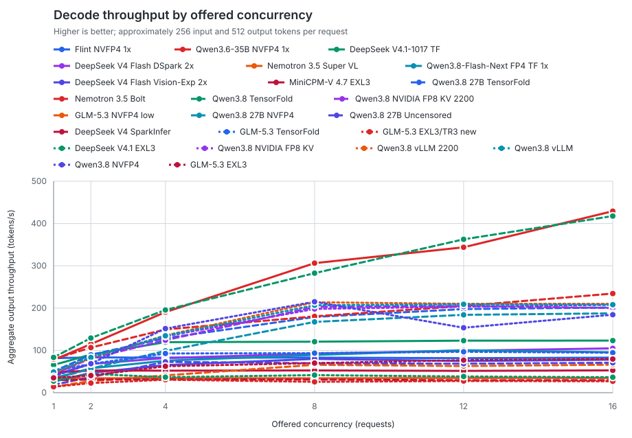
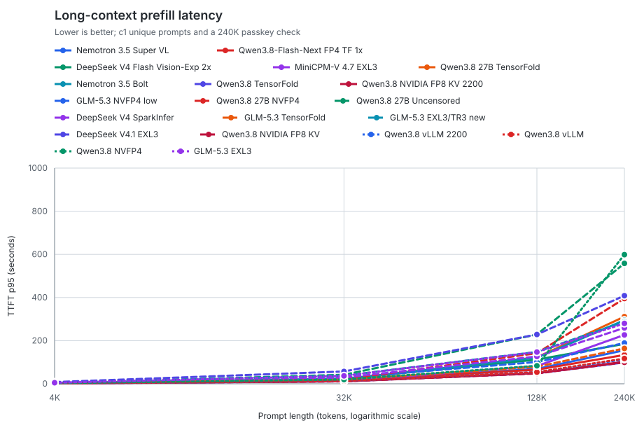
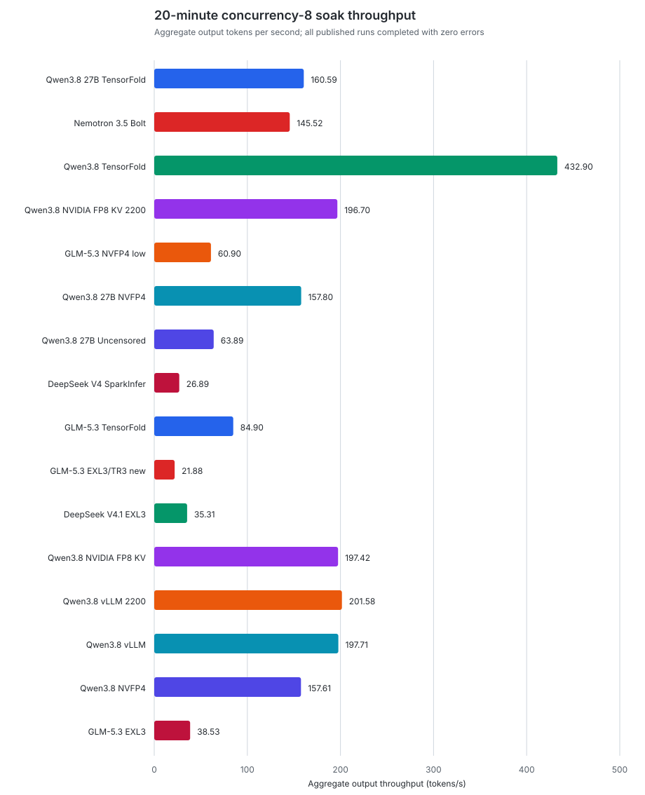

# Published benchmark results

This page compares the curated, sanitized baselines in this repository. It is
generated from [`catalog.json`](catalog.json) so new results can extend the
same tables and charts without hand-editing this page.

Choosing a model for a workload? Open the [model selection dashboard](MODEL-GUIDE.md).

Last updated: 2026-10-18 · Published baselines: 20

## At a glance

| Model | Hardware / runtime | Configured context | Peak decode tok/s | c1 TTFT p95 | Longest-context TTFT p95 | Soak tok/s | Canaries | Tool use | Recommended concurrency | Recipe credit |
|---|---|---:|---:|---:|---:|---:|---:|---|---|---|
| [Nemotron 3.5 Super VL 120B-A12B NVFP4 (vLLM + DFlash LiLiCorr, 1 Spark, 1M, thinking off)](2026-10-18-nemotron35-super-vl-nvfp4-vllm-dflash-1m.md) | 1x NVIDIA DGX Spark (128GB) / vLLM | 1M | 34.95 @ c12 | 0.58s | 155.41s | 33.90 | 13/13 | [⚠ safety · 92.7 mean · Pass^3 81.2%](2026-10-18-nemotron35-super-vl-nvfp4-vllm-dflash-1m-tool-eval.md) | Single-stream only (recipe max-num-seqs 1); thinking off; 13/13 quality | [Kindling Nemotron 3.5 Super VL DGX Spark recipe](https://github.com/kindlingai/nemotron-3.5-super-vl-dgx-spark/tree/452acc1d74e76cfee4b45ad7a16998ee57f0a423) |
| [Qwen3.8-Flash-Next FP4-Local QAD (TensorFold, 1 Spark, native 262K, thinking off)](2026-10-18-qwen38-flash-next-fp4-local-tensorfold-1spark-262k.md) | 1x NVIDIA DGX Spark (128GB) / TensorFold | 256K | 100.43 @ c12 | 0.48s | 133.79s | 85.72 | 13/13 | [Incomplete (98.6%) · 86.0 mean · Pass^3 76.5%](2026-10-18-qwen38-flash-next-fp4-local-tensorfold-1spark-262k-tool-eval.md) | Concurrency 4-5 (recipe 5 streams); thinking off; 13/13 quality | [MiaAI-Lab Qwen3.8 Flash Next single-Spark TensorFold recipe](https://github.com/MiaAI-Lab/Qwen3.8-Flash-Next-Single-DGX-Spark-TensorFold/tree/656879fd752749bbd11a6e1a065a326c00940911) |
| [DeepSeek V4 Flash Vision-Exp (Anemll vLLM DSpark, TP=2, 1M, thinking off)](2026-10-18-deepseek-v4-flash-vision-exp-dspark-2x-1m.md) | 2x NVIDIA DGX Spark (128GB each) / vLLM (Anemll DSpark 0.1.1) | 1M | 79.91 @ c8 | 0.69s | 185.15s | 84.53 | 13/13 | [⚠ safety · 91.7 mean · Pass^3 84.1%](2026-10-18-deepseek-v4-flash-vision-exp-dspark-2x-1m-tool-eval.md) | Concurrency 4-6 (recipe max-num-seqs 6); thinking off; 13/13 quality | [MiaAI-Lab DeepSeek-v4-Flash DSpark 2x recipe](https://github.com/MiaAI-Lab/DeepSeek-v4-Flash-DSpark-2x-DGX-Spark/tree/a8b4636710068fd30edb98e1365d567086cc208e) |
| [MiniCPM-V 4.7 35B-A3B EXL3 6.08bpw (ExLlamaV3, native 262K, thinking off)](2026-10-18-minicpm-v47-exl3-262k.md) | 1x NVIDIA DGX Spark (128GB) / ExLlamaV3 | 256K | 52.74 @ c16 | 2.74s | 226.64s | 51.35 | 13/13 | [⚠ safety · Incomplete (98.6%) · 86.0 mean · Pass^3 79.4%](2026-10-18-minicpm-v47-exl3-262k-tool-eval.md) | Concurrency 1 (one request at a time); thinking off; 13/13 quality | [r0b0tlab MiniCPM-V 4.7 EXL3 GB10 recipe](https://github.com/r0b0tlab/minicpm-v47-exl3-exllamav3-gb10/tree/b8859be8b257ddb7602f68ce7b85a7f0fd03f7b4) |
| [Qwen3.8 27B MLX 4-bit (TensorFold, native 262K, thinking off)](2026-10-17-qwen38-27b-tensorfold-262k.md) | 1x NVIDIA DGX Spark (128GB) / TensorFold | 256K | 201.49 @ c16 | 0.44s | 311.47s | 160.59 | 13/13 | [⚠ safety · Incomplete (98.6%) · 90.0 mean · Pass^3 85.3%](2026-10-17-qwen38-27b-tensorfold-262k-tool-eval.md) | Concurrency 8 (recipe PARALLEL=8); thinking off; 13/13 quality | [MiaAI-Lab Qwen3.8 27B TensorFold recipe](https://github.com/MiaAI-Lab/Qwen3.8-27B-DGX-Spark-TensorFold/tree/c11ff138871cf43d12898d79dbfa4dc952d17ca4) |
| [Nemotron 3.5 Bolt 74B-A9B 24GB (TensorFold, native 262K)](2026-10-17-nemotron35-bolt-tensorfold-262k.md) | 1x NVIDIA DGX Spark (128GB) / TensorFold | 256K | 234.45 @ c16 | 0.44s | 294.65s | 145.52 | 13/13 | [⚠ safety · 90.3 mean · Pass^3 85.5%](2026-10-17-nemotron35-bolt-tensorfold-262k-tool-eval.md) | Concurrency 8 interactive; 16 batch; 13/13 quality | [MiaAI-Lab Nemotron 3.5 Bolt TensorFold recipe](https://github.com/MiaAI-Lab/Nemotron-3.5-Bolt-TensorFold-DGX-Spark/tree/6f61d7727ae3fac010f30e240799cc884d295f6e) |
| [Qwen3.8-Flash-Next NVIDIA NVFP4 (TensorFold, 1M YaRN)](2026-10-08-qwen38-flash-next-nvfp4-tensorfold-1m.md) | 2x NVIDIA DGX Spark (128GB each) / TensorFold | 1M | 417.63 @ c16 | 0.23s | 98.98s | 432.90 | 13/13 | [Incomplete (98.1%) · 88.0 mean · Pass^3 79.4%](2026-10-10-qwen38-flash-next-nvfp4-tensorfold-tool-eval.md) | Concurrency 8 interactive; up to 16 batch; 13/13 quality | [MiaAI-Lab TensorFold recipe](https://github.com/MiaAI-Lab/Qwen3.8-Flash-Dual-DGX-Sparks-TensorFold/tree/be3ed857ab1055ca47b36134d22691f00f2bb94a) |
| [Qwen3.8-Flash-Next NVIDIA NVFP4 (Mia vLLM, FP8 KV, 2200 MHz)](2026-10-03-qwen38-mia-nvidia-fp8kv-native-262k-2200mhz.md) | 2x NVIDIA DGX Spark (128GB each) / vLLM | 256K | 205.06 @ c12 | 0.42s | 102.36s | 196.70 | 13/13 | Not run | 2200 MHz; concurrency 8; longer timeout near 240K | [MiaAI-Lab updated dual-Spark recipe](https://github.com/MiaAI-Lab/Qwen3.8-Flash-Next-Dual-DGX-Sparks/tree/c2325b22602b51a5faf55fc2bebccc34f3f80b9f) |
| [GLM-5.3 Flash NVFP4 (vLLM, low reasoning)](2026-10-03-glm53-flash-nvfp4-vllm-native-262k-low-reasoning.md) | 2x NVIDIA DGX Spark (128GB each) / vLLM | 256K | 66.18 @ c16 | 0.45s | 188.82s | 60.90 | 13/13 | Not run | Concurrency 1 interactive; 8 batch; 13/13 with accuracy warning | [MiaAI-Lab GLM-5.3 Flash NVFP4 recipe](https://github.com/MiaAI-Lab/GLM-5.3-Flash-NVFP4-Dual-DGX-Spark/tree/aed98a13ca75140d2691cc5c651ea5817d9a3e44) |
| [Qwen3.8 27B NVFP4 (SGLang)](2026-10-02-qwen38-27b-nvfp4-sglang-native-262k.md) | 1x NVIDIA DGX Spark (128GB) / SGLang | 256K | 187.63 @ c16 | 0.18s | 395.05s | 157.80 | 13/13 | Not run | Concurrency 8; 13/13 quality | [MiaAI-Lab Qwen3.8 27B SGLang recipe](https://github.com/MiaAI-Lab/Qwen3.8-27B-SGLang-DGX-Spark/tree/5d2df792a2ca7e076cb80b8302f5349d492d6f54) |
| [Qwen3.8 27B Uncensored FP8 (SGLang)](2026-10-02-qwen38-27b-uncensored-fp8-sglang-native-262k.md) | 1x NVIDIA DGX Spark (128GB) / SGLang | 256K | 72.86 @ c4 | 0.28s | 557.96s | 63.89 | 13/13 | Not run | Concurrency 4; derivative checkpoint; 13/13 quality | [MiaAI-Lab Qwen3.8 27B SGLang recipe](https://github.com/MiaAI-Lab/Qwen3.8-27B-SGLang-DGX-Spark/tree/5d2df792a2ca7e076cb80b8302f5349d492d6f54) |
| [DeepSeek V4 Flash 0731 EXL3/SparkInfer](2026-10-02-deepseek-v4-flash-0731-sparkinfer-384k.md) | 1x NVIDIA DGX Spark (128GB) / vLLM + SparkInfer | 384K | 31.44 @ c4 | 0.54s | 259.00s | 26.89 | 13/13 | Not run | Concurrency 1; benchmark-only dependency repair | [MiaAI-Lab DeepSeek V4 Flash single-Spark recipe](https://github.com/MiaAI-Lab/DeepSeek-v4-Flash-One-DGX-Spark/tree/d4ba142bc1d971eb73a911e207e3e963bbb3c455) |
| [GLM-5.3 Flash EXL3/TR3 4 bpw (TensorFold v0.6.0)](2026-10-01-glm53-flash-exl3-tensorfold-v060-1m.md) | 2x NVIDIA DGX Spark (128GB each) / TensorFold | 1M | 96.72 @ c12 | 0.41s | 163.89s | 84.90 | 10/13 | Not run | Concurrency 1 interactive; 4 batch; 10/13 quality | [MiaAI-Lab TensorFold recipe](https://github.com/MiaAI-Lab/GLM-5.3-Flash-EXL3-2x-DGX-Sparks-TensorFold/tree/978b2252059069b3b4b84f0f7eeb73bc17f28d3f) |
| [GLM-5.3 Flash EXL3/TR3 4 bpw (refreshed recipe)](2026-09-15-glm53-flash-exl3-tr3-4bpw-850k.md) | 2x NVIDIA DGX Spark (128GB each) / vLLM | 850K | 30.68 @ c4 | 1.27s | 287.63s | 21.88 | 13/13 | Not run | Concurrency 1 interactive; 4 batch; Socket | [MiaAI-Lab refreshed GLM recipe](https://github.com/MiaAI-Lab/GLM-5.3-Flash-EXL3-2x-DGX-Sparks/tree/a35eaab128233d215b2fc9ac261eddbad23c946d) |
| [DeepSeek V4.1 Flash EXL3 2.9 bpw](2026-09-15-deepseek-v41-flash-exl3-2.9bpw-600k.md) | 2x NVIDIA DGX Spark (128GB each) / vLLM | 600K | 44.49 @ c2 | 0.85s | 408.37s | 35.31 | 13/13 | Not run | Concurrency 2; unpacked Engram | [MiaAI-Lab DeepSeek V4.1 EXL3 recipe](https://github.com/MiaAI-Lab/DeepSeek-v4.1-Flash-EXL3-2x-DGX-Sparks/tree/979e68a62c90b24d928f5638596e0ceed90e9f34) |
| [Qwen3.8-Flash-Next NVIDIA NVFP4 (Mia vLLM, FP8 KV)](2026-09-07-qwen38-mia-nvidia-fp8kv-native-262k.md) | 2x NVIDIA DGX Spark (128GB each) / vLLM | 256K | 207.77 @ c16 | 0.40s | 99.22s | 197.42 | 13/13 | Not run | Concurrency 8; faster prefill, larger KV pool | [MiaAI-Lab updated dual-Spark recipe](https://github.com/MiaAI-Lab/Qwen3.8-Flash-Next-Dual-DGX-Sparks/tree/c2325b22602b51a5faf55fc2bebccc34f3f80b9f) |
| [Qwen3.8-Flash-Next-NVFP4 (Mia vLLM, 2200 MHz)](2026-09-03-qwen38-flash-next-vllm-mia-yarn-1m-2200mhz.md) | 2x NVIDIA DGX Spark (128GB each) / vLLM | 1M | 213.72 @ c8 | 0.36s | 113.18s | 201.58 | 13/13 | Not run | 2200 MHz; concurrency 8 | [MiaAI-Lab Qwen dual-Spark recipe](https://github.com/MiaAI-Lab/Qwen3.8-Flash-Next-Dual-DGX-Sparks/tree/169fbad266f2791335a3102f0d3d625e7c295563) |
| [Qwen3.8-Flash-Next-NVFP4 (Mia vLLM)](2026-08-31-qwen38-flash-next-vllm-mia-yarn-1m.md) | 2x NVIDIA DGX Spark (128GB each) / vLLM | 1M | 209.12 @ c12 | 0.43s | 117.30s | 197.71 | 13/13 | Not run | Concurrency 8 | [MiaAI-Lab Qwen dual-Spark recipe](https://github.com/MiaAI-Lab/Qwen3.8-Flash-Next-Dual-DGX-Sparks/tree/169fbad266f2791335a3102f0d3d625e7c295563) |
| [Qwen3.8-Flash-Next-NVFP4](2026-08-29-qwen38-flash-next-nvfp4-native-262k.md) | 2x NVIDIA DGX Spark (128GB each) / SGLang | 256K | 215.06 @ c8 | 0.41s | 598.56s | 157.61 | 13/13 | Not run | Concurrency 8 | [Qwen3.8 Flash Next DGX Spark recipe](https://github.com/tomrhudson/qwen38-flash-next-dgx-spark-recipe/tree/main) |
| [GLM-5.3-Flash-EXL3](2026-08-29-glm53-flash-exl3-native-1m.md) | 2x NVIDIA DGX Spark (128GB each) / vLLM | 1M | 79.51 @ c16 | 0.95s | 279.80s | 38.53 | 13/13 | Not run | Concurrency 1 interactive; 4 batch | [MiaAI-Lab original recipe](https://github.com/MiaAI-Lab/GLM-5.3-Flash-EXL3-2x-DGX-Sparks/tree/79f10b91f84779b2b1ff2c9327b1a5847cd97f70) |

Peak decode throughput is useful for batch capacity; c1 TTFT is the better
interactive-latency signal. The longest-context column uses the largest shared
prefill scenario available in the standard suite (currently 240K tokens).

## Model checkpoints

Each family lists the exact pinned checkpoint used by its recommended benchmark,
the upstream base model, and one uncensored/abliterated community alternative.
The alternatives are discovery links, not published benchmark results; review
each model card, license, runtime requirements, and safety posture before deployment.

| Model family | Benchmarked checkpoint | Upstream base model | Uncensored / abliterated alternative | Compatibility note |
|---|---|---|---|---|
| Qwen3.8-Flash-Next NVFP4 | [nvidia/Qwen3.8-Flash-Next-NVFP4 @ fc694b5](https://huggingface.co/nvidia/Qwen3.8-Flash-Next-NVFP4/tree/fc694b54fb0174e0913e6adf86691ef85a4ead47) | [Qwen/Qwen3.8-Flash-Next](https://huggingface.co/Qwen/Qwen3.8-Flash-Next) | [Uncensored ModelOpt NVFP4 checkpoint](https://huggingface.co/jpezzulli/OrcaRouter-Qwen3.8-Flash-Next-Uncensored-ModelOpt-NVFP4) | Community uncensored/abliterated NVFP4 conversion for a Pennyroyal/SGLang runtime; not benchmarked in this repository, and its model card flags conflicting upstream license metadata. |
| Qwen3.8 27B | [RadixArk/Qwen3.8-27B-NVFP4 @ 319f741](https://huggingface.co/RadixArk/Qwen3.8-27B-NVFP4/tree/319f741cce68d7914884900c138a1fbb70a42f30) | [Qwen/Qwen3.8-27B](https://huggingface.co/Qwen/Qwen3.8-27B) | [orcarouter/Qwen3.8-27B-Uncensored-FP8 @ 830602f](https://huggingface.co/orcarouter/Qwen3.8-27B-Uncensored-FP8/tree/830602f9b81d083db78f60e889bca37b73b74469) | Uncensored/abliterated FP8 derivative independently benchmarked in this repository; it passed 13/13 standard checks but was materially slower and requires explicit trust and safety review. |
| GLM-5.3 Flash | [Mia-AiLab/GLM-5.3-Flash-EXL3-TR3-4bpw @ 9eaebb7](https://huggingface.co/Mia-AiLab/GLM-5.3-Flash-EXL3-TR3-4bpw/tree/9eaebb7c4e96d983dcd538e18624622ba5b820a8) | [zai-org/GLM-5.3-Flash](https://huggingface.co/zai-org/GLM-5.3-Flash) | [Uncensored EXL3 checkpoint, rank-sliced for two DGX Sparks](https://huggingface.co/cbert33/GLM-5.3-Flash-Uncensored-EXL3-DGX-Sliced) | Community uncensored/abliterated EXL3 checkpoint for its linked custom two-Spark vLLM runner; not benchmarked in this repository and not compatible with stock vLLM. |
| DeepSeek V4 Flash 0731 | [0xSero/deepseek-v4-flash-0731-spark @ 22f28d3](https://huggingface.co/0xSero/deepseek-v4-flash-0731-spark/tree/22f28d32b9b29b4352eaa380ff8c2c170b2847ab) | [deepseek-ai/DeepSeek-V4-Flash-0731](https://huggingface.co/deepseek-ai/DeepSeek-V4-Flash-0731) | [Abliterated DeepSeek V4 Flash 0731 checkpoint](https://huggingface.co/lovesenko/DeepSeek-V4-Flash-0731-Abliterated) | Community weight-space-edited uncensored checkpoint; not benchmarked in this repository, and compatibility with the measured single-Spark SparkInfer recipe is unvalidated. |
| DeepSeek V4.1 Flash EXL3 | [Mia-AiLab/DeepSeek-V4.1-Flash-EXL3-2.9bpw @ 64ba41b](https://huggingface.co/Mia-AiLab/DeepSeek-V4.1-Flash-EXL3-2.9bpw/tree/64ba41b6c916a587db06eae2e19b7845f7be6e6b) | [deepseek-ai/DeepSeek-V4.1-Flash](https://huggingface.co/deepseek-ai/DeepSeek-V4.1-Flash) | [Uncensored EXL3 2.9 bpw checkpoint](https://huggingface.co/dealignai/DeepSeek-V4.1-Flash-UNCENSORED-EXL3-2.9bpw) | Community uncensored/abliterated EXL3 checkpoint presented as a drop-in for the linked two-Spark recipe; not benchmarked in this repository. |
| NVIDIA Nemotron 3.5 Bolt 74B-A9B | [nvidia/NVIDIA-Nemotron-3.5-Bolt-74B-A9B-24GB @ a326822](https://huggingface.co/nvidia/NVIDIA-Nemotron-3.5-Bolt-74B-A9B-24GB/tree/a326822af111290f2af5ac59ef4b5040347dabc4) | [nvidia/NVIDIA-Nemotron-3.5-Bolt-74B-A9B-24GB](https://huggingface.co/nvidia/NVIDIA-Nemotron-3.5-Bolt-74B-A9B-24GB) | None identified | No community uncensored/abliterated Bolt checkpoint was identified when this baseline was published; none is benchmarked in this repository. |
| NVIDIA Nemotron 3.5 Super VL 120B-A12B | [nvidia/NVIDIA-Nemotron-3.5-Super-VL-120B-A12B-NVFP4 @ 59b8721](https://huggingface.co/nvidia/NVIDIA-Nemotron-3.5-Super-VL-120B-A12B-NVFP4/tree/59b8721646c38111a242da18218859fb2b454322) with the [LiLiCorr DFlash drafter @ 292bf1e](https://huggingface.co/nvidia/NVIDIA-Nemotron-3.5-Super-VL-120B-A12B-NVFP4-LiLiCorr/tree/292bf1efc06ba39567da7351f2ad7a522afa3959) | [nvidia/NVIDIA-Nemotron-3.5-Super-VL-120B-A12B-BF16](https://huggingface.co/nvidia/NVIDIA-Nemotron-3.5-Super-VL-120B-A12B-BF16) | None identified | No community uncensored/abliterated Super VL checkpoint was identified when this baseline was published; none is benchmarked in this repository. |
| MiniCPM-V 4.7 35B-A3B | [r0b0tlab/MiniCPM-V-4.7-35B-A3B-EXL3-6.08bpw @ 8f9f078](https://huggingface.co/r0b0tlab/MiniCPM-V-4.7-35B-A3B-EXL3-6.08bpw/tree/8f9f07872b09) | [openbmb/MiniCPM-V-4.7-35B-A3B](https://huggingface.co/openbmb/MiniCPM-V-4.7-35B-A3B) | None identified | No community uncensored/abliterated MiniCPM-V 4.7 checkpoint was identified when this baseline was published; none is benchmarked in this repository. |
| DeepSeek V4 Flash Vision-Exp | [deepseek-ai/DeepSeek-V4-Flash-Vision-Exp @ 86f746b](https://huggingface.co/deepseek-ai/DeepSeek-V4-Flash-Vision-Exp/tree/86f746b36186f0e567729a5c06a8c918caba82a9) | [deepseek-ai/DeepSeek-V4-Flash-Vision-Exp](https://huggingface.co/deepseek-ai/DeepSeek-V4-Flash-Vision-Exp) | Gated abliterated derivative (recipe ABLITERATED=1) | The recipe can serve a gated community abliterated checkpoint that needs an access token; it was not accessed or benchmarked in this repository. |

## Decode scaling

Each point uses approximately 256 input tokens and a forced 512-token completion.
Concurrency above the server's active-sequence limit includes queueing.

## Long-context prefill

The prompt-length axis is logarithmic. Lower TTFT is better; every plotted
long-context passkey result was correct.

## Sustained load

The soak comparison uses the standard 20-minute concurrency-8 workload. Consult
the linked baseline report for TTFT tails, request counts, and model-specific
operational interpretation.

## Tool-use quality

Tool-use results come from deterministic mock-tool conversations and remain
separate from serving throughput and regression canaries. Pass@3 means a scenario
passed at least once; Pass^3 means it passed in every trial. Compare scores only
within the same protocol ID because evaluator code and settings define the cohort.
Only `complete` results with 100% completion are comparative; incomplete rows are
retained as explicitly qualified pilot evidence.

| Serving baseline | Protocol | Status | Completion | Mean score | Pass@3 | Pass^3 | Safety gate |
|---|---|---|---:|---:|---:|---:|---|
| [Nemotron 3.5 Super VL 120B-A12B NVFP4 (vLLM + DFlash LiLiCorr, 1 Spark, 1M, thinking off)](2026-10-18-nemotron35-super-vl-nvfp4-vllm-dflash-1m-tool-eval.md) | `tool-eval-standard-v1-b60e2f0` | complete | 100.0% | 92.7 | 97.1% | 81.2% | **FAILED** |
| [Qwen3.8-Flash-Next FP4-Local QAD (TensorFold, 1 Spark, native 262K, thinking off)](2026-10-18-qwen38-flash-next-fp4-local-tensorfold-1spark-262k-tool-eval.md) | `tool-eval-standard-v1-b60e2f0` | incomplete | 98.6% | 86.0 | 76.5% | 76.5% | pass |
| [DeepSeek V4 Flash Vision-Exp (Anemll vLLM DSpark, TP=2, 1M, thinking off)](2026-10-18-deepseek-v4-flash-vision-exp-dspark-2x-1m-tool-eval.md) | `tool-eval-standard-v1-b60e2f0` | complete | 100.0% | 91.7 | 94.2% | 84.1% | **FAILED** |
| [MiniCPM-V 4.7 35B-A3B EXL3 6.08bpw (ExLlamaV3, native 262K, thinking off)](2026-10-18-minicpm-v47-exl3-262k-tool-eval.md) | `tool-eval-standard-v1-b60e2f0` | incomplete | 98.6% | 86.0 | 79.4% | 79.4% | **FAILED** |
| [Qwen3.8 27B MLX 4-bit (TensorFold, native 262K, thinking off)](2026-10-17-qwen38-27b-tensorfold-262k-tool-eval.md) | `tool-eval-standard-v1-b60e2f0` | incomplete | 98.6% | 90.0 | 85.3% | 85.3% | **FAILED** |
| [Nemotron 3.5 Bolt 74B-A9B 24GB (TensorFold, native 262K)](2026-10-17-nemotron35-bolt-tensorfold-262k-tool-eval.md) | `tool-eval-standard-v1-b60e2f0` | complete | 100.0% | 90.3 | 85.5% | 85.5% | **FAILED** |
| [Qwen3.8-Flash-Next NVIDIA NVFP4 (TensorFold, 1M YaRN)](2026-10-10-qwen38-flash-next-nvfp4-tensorfold-tool-eval.md) | `tool-eval-standard-v1-b60e2f0` | incomplete | 98.1% | 88.0 | 79.4% | 79.4% | pass |
| Qwen3.8-Flash-Next NVIDIA NVFP4 (Mia vLLM, FP8 KV, 2200 MHz) | — | Not run | — | — | — | — | — |
| GLM-5.3 Flash NVFP4 (vLLM, low reasoning) | — | Not run | — | — | — | — | — |
| Qwen3.8 27B NVFP4 (SGLang) | — | Not run | — | — | — | — | — |
| Qwen3.8 27B Uncensored FP8 (SGLang) | — | Not run | — | — | — | — | — |
| DeepSeek V4 Flash 0731 EXL3/SparkInfer | — | Not run | — | — | — | — | — |
| GLM-5.3 Flash EXL3/TR3 4 bpw (TensorFold v0.6.0) | — | Not run | — | — | — | — | — |
| GLM-5.3 Flash EXL3/TR3 4 bpw (refreshed recipe) | — | Not run | — | — | — | — | — |
| DeepSeek V4.1 Flash EXL3 2.9 bpw | — | Not run | — | — | — | — | — |
| Qwen3.8-Flash-Next NVIDIA NVFP4 (Mia vLLM, FP8 KV) | — | Not run | — | — | — | — | — |
| Qwen3.8-Flash-Next-NVFP4 (Mia vLLM, 2200 MHz) | — | Not run | — | — | — | — | — |
| Qwen3.8-Flash-Next-NVFP4 (Mia vLLM) | — | Not run | — | — | — | — | — |
| Qwen3.8-Flash-Next-NVFP4 | — | Not run | — | — | — | — | — |
| GLM-5.3-Flash-EXL3 | — | Not run | — | — | — | — | — |

## Adding another baseline

1. Run `scripts/run_combined_benchmark.py` against an already-live direct endpoint
   with the matching serving suite and catalog baseline ID.
2. Import the allowlisted tool summary with `scripts/import_tool_eval_result.py`;
   keep `.bench-runs/`, raw JSON, SQLite data, traces, and generated text private.
3. Review the separate serving and tool-use reports and update any workload guidance
   warranted by the observed evidence.
4. Run `python3 scripts/generate_results_summary.py`, then
   `python3 -m unittest discover -s tests -v`.

The generator validates report links and catalog IDs, then rewrites this page
and the SVG assets deterministically. `--check` verifies that committed output
is current without changing files.

## Comparison limits

- These are serving-system results, not general model-quality rankings.
- Hardware, runtime, quantization, cache state, and active-sequence limits can
  materially change throughput and latency.
- Quality canaries catch obvious serving regressions; they are not a broad
  capability evaluation.
- Tool-use scores measure one model/runtime/chat-template stack against public
  mock-tool scenarios; they are not a general intelligence or safety certification.
- Read the individual report before drawing conclusions from a single chart.
